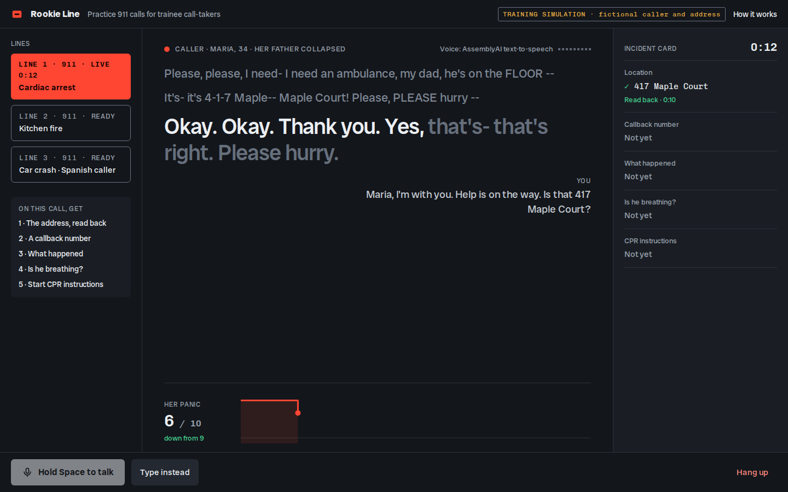
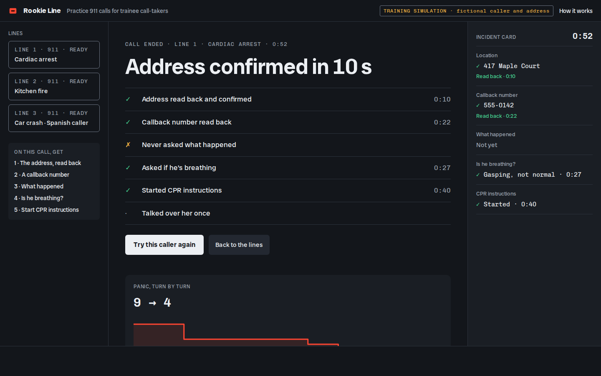

# Rookie Line

**Try it live:** [rookie-line.vercel.app](https://rookie-line.vercel.app) (no sign-in; a headset helps, or type your side, or press "Hear a sample call")

**Rookie Line puts a 911 trainee on a live call with a panicked caller who stammers and cuts off, and whose voice steadies only when they handle her right.** Built for AssemblyAI's "Voice hackathon week: Hack into speech" on its new Text-to-Speech API.



New call-takers learn to pull an address out of a frightened caller by role-play, and a trainer has to play the caller for every repetition: one dispatch centre told [Police1](https://www.police1.com/innovation-report/the-future-of-the-telecommunicator-how-ai-is-changing-dispatcher-training) that building that repetition "often meant asking trainers to play the caller during role-playing exercises". Rookie Line is a caller a trainee can practise on alone.

## Try it

Answer the ringing line, hold **Space** to talk (or type), get the address and a callback number, read them back, give the caller something to do, and hang up for the scorecard. Talk over her and she stops mid-word; say her name and tell her help is coming, and you will hear her steady.

| Do this | What should happen |
|---|---|
| Press **Answer line 1** | She starts talking at once, panicked ("Hello?! Hello, please, it's my DAD…") |
| Hold Space: "911, what's the address of your emergency?" | "It's- it's 4-1-7 Maple-- Maple Court! Please, PLEASE hurry!" and the Location slot shows *Heard* |
| Hold Space while she is talking | Her audio stops mid-word and her caption ends at the last word you heard |
| "Maria, I'm with you. Help is on the way. 417 Maple Court?" | Location turns green (*Read back*), her panic drops, and her next line is calmer |
| "I have 471 Maple Court" | "No-- no! It's 4-1-7 Maple-- Maple Court!" and the slot marks the wrong read-back |
| **Hang up** | The scorecard: seconds to a confirmed address, what you read back, what you missed, and why her panic moved |

No mic, or want to hear it first? **Hear a sample call** plays a one-minute call on the same screen: the caller's lines come from the same engine, both voices are AssemblyAI text-to-speech, and the trainee's side is scripted.

Three lines: a cardiac arrest (English), a kitchen fire with an elderly man who wants to go back for his dog (English), and a car crash where the caller speaks Spanish.

## How it works



- **Her voice** is AssemblyAI's streaming text-to-speech, one WebSocket session per call, opened while the line rings so her first words play about 0.3 s after you answer. Cutting in sends `Cancel`; word timings light the captions as she speaks.
- **How scared she sounds is decided in code.** A panic level from 0 to 10 picks which written version of each line she says: at the top she starts words twice ("he's- he's"), says "uh", shouts one word and trails off ("--"); low down she speaks in plain sentences. Calming cues (her name, "I'm with you", "help is on the way", "breathe") lower it; talking over her, silence and a bare "calm down" raise it. The TTS reads the stumbles exactly as written.
- **The facts come from code.** The address and phone number live in the scenario and are filled in by code at her current panic level; your read-back is turned into digits ("four seventeen", "4-1-7", "cuatro uno siete") and compared.
- **Your side** is AssemblyAI's Universal-3.6 Pro streaming speech-to-text. Push-to-talk: releasing Space sends `ForceEndpoint`, so your turn ends at once (about 0.16 s to the final transcript in our tests), with the scenario's names as key terms.
- **Unplanned questions** ("Does he take any medication?") go to AssemblyAI's LLM Gateway, which phrases an answer in character; any number it writes is removed, and if it takes over 2.5 s she falls back to a written line.

Measured in a browser run on 3 November 2026: her first words 0.29–0.31 s after Answer; from releasing Space to her voice 0.78–0.86 s on planned questions; about 1.8 s when the model answers.

## What is live and what is not

| Part | Status |
|---|---|
| The caller's voice | live: AssemblyAI streaming text-to-speech |
| Your speech | live: AssemblyAI Universal-3.6 Pro streaming speech-to-text |
| Answers to unplanned questions | live: AssemblyAI LLM Gateway (`qwen3.5-4b-32k-fast`), fenced by code |
| Panic, facts, read-back checks, scoring | deterministic code (`lib/engine`), 37 tests |
| The emergencies | training scenarios: the callers, addresses and phone numbers are fictional |
| The sample call and sample scorecard | the same engine run on a scripted trainee; both voices pre-rendered with AssemblyAI text-to-speech (`scripts/render-sample.mts`), labelled as a sample |

## Limits

- A training simulation with three scenarios. Scoring checks facts and timing, not tone or protocol wording.
- Push-to-talk rather than an open line, so the caller's own voice cannot interrupt you through the speakers.
- English and Spanish only.

## Run it

```bash
npm install
echo "ASSEMBLYAI_API_KEY=your-key" > .env.local
npm run dev            # http://localhost:3000
npm test               # engine, voice helpers and model-fallback tests
```

`/?state=live|typed|scorecard|connecting|error` renders each screen from the sample run, for checking without a call.

## How this was built

Planned and built inside the event window, starting 3 November 2026: idea research, a UI mockup, then the code (see `.prod-build/` for the contract and plan). Code was written with an AI coding assistant.
